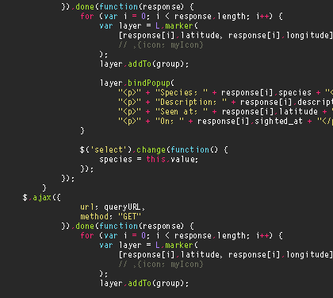

 

<h3> Olá, eu sou Thiago Mauricio! Seja bem vindo(a) ao meu perfil GitHub! 👋🏻 </h3>
<h4>IT Infrastructure | Network | DevOps</h4>

<h6> 💫 #infraestrutura, #redes, #linux, #devops, #monitoramento e #tecnologia </h6>
  

  

<ul>
  <li>🤩 Apaixonado por tecnologia, infraestrutura, inovação e aprendizado contínuo.</li>
  <li>💻 Atuo com <b>Infraestrutura de TI, Redes e Suporte Computacional</b>, trabalhando com administração de servidores, monitoramento e sustentação de ambientes corporativos.</li>
  <li>🖥️ Experiência com ambientes <b>Linux e Windows</b>, administração de servidores, redes, troubleshooting e serviços de infraestrutura.</li>
  <li>📊 Trabalho com <b>Zabbix e Grafana</b> na implementação e administração de ambientes de monitoramento, dashboards, alertas e acompanhamento de disponibilidade.</li>
  <li>⚙️ Desenvolvo automações utilizando <b>Python e Shell Script (Bash)</b>, integrando ferramentas e otimizando processos operacionais.</li>
  <li>🗄️ Experiência com bancos de dados <b>MySQL e MariaDB</b>, além de ferramentas de inventário e gestão de ativos como OCS Inventory.</li>
  <li>🚀 Em constante evolução nas áreas de <b>Infraestrutura, Redes, Observabilidade, Automação e Engenharia DevOps</b>.</li>
  <li>🎓 Formação em Redes de Computadores e Engenharia DevOps.</li>
  <li>🌎 Inglês básico a intermediário.</li>
  <li>
    

      
👽 Curiosidades:

      <ul>
        <li>🤖 Nas horas vagas curto pedalar.</li>
        <li>⛩️ Já pedalei 150 km no mesmo dia.</li>
        <li>💡 Gosto de explorar novas tecnologias e encontrar soluções para desafios do dia a dia em TI.</li>
      </ul>
    

  </li>
</ul>

 

  

 

  
 
    

   <h1 align="center">Tecnologias e Ferramentas <3</h1>

   

   

   

   

   

   

   

   

   

  

  

    <h1 align="center">Redes Sociais</h1>

   

   

   
  

   

  

  <i> A magical universe can be born from small ideas! ⭐️</i>
    
  

